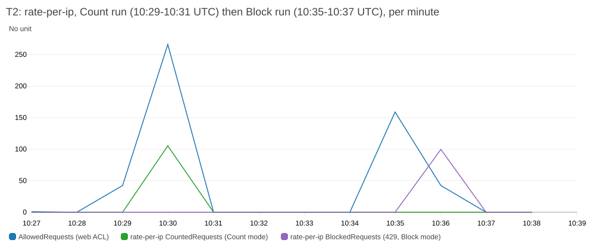
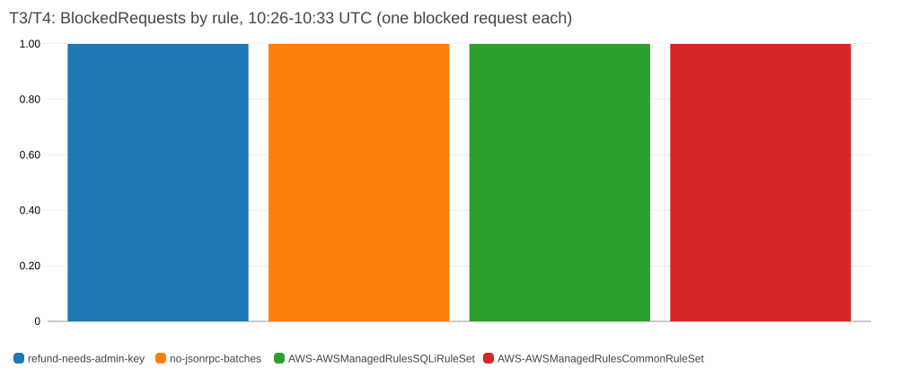

# Lab results: MCP server behind CloudFront + WAF

These results come from one end-to-end run of this repo against real AWS on **2026-11-12** (UTC). Everything below was measured. The raw captures are in [`raw/`](raw/) and the metric graphs are the PNGs in this folder.

| | |
|---|---|
| Account / region | `137914536528` (an admin role in a sandbox account), `us-east-1` |
| Stack | `McpEdgeLab`; deploy started 10:21:35Z, `CREATE_COMPLETE` 10:21:59Z (first attempt), tests 10:28Z–10:56Z |
| CloudFront URL | **https://dnsos9eefh1lh.cloudfront.net/** (distribution `ELK2FOH46UIKE`) |
| Runtime | `arn:aws:bedrock-agentcore:us-east-1:137914536528:runtime/orders_mcp-Mk7eFE6d96` |
| Web ACL | `mcp-edge` (`3c510b92-…`), **1,140 WCU** |
| WAF log group | `aws-waf-logs-mcp-edge` |
| Client | MacBook (macOS) in **Brisbane, Australia**, over **IPv6**. CloudFront POP `BNE50-P2` |
| Build path | No Docker. `AgentRuntimeArtifact.fromCodeAsset` (AgentCore direct code deployment, Python 3.12, ARM64). Dependencies cross-installed by `uv` for `aarch64-manylinux2014`. See [README](../README.md#prerequisites) |
| Final state | **Still deployed** with `rateAction=block`, origin request policy `AllViewer` |

Client IPs in the log extracts are masked to the first two IPv6 hextets. Tokens and the admin key exist only in shell variables and were never written to disk. The WAF logging config redacts both `authorization` and `x-admin-key`. The proof is under [T3](#t3-refund-guard-rules-70-and-60).

## Summary

| Test | Expected (article) | Actual | Pass? |
|---|---|---|---|
| §2 naked test (direct URL) | 4 × 200 incl. refund | 4 × 200 incl. refund, 401 without token | ✅ |
| T1 SDK through CloudFront | 3 tool names + order | 3 tool names + order, `ALLOW`/`Default_Action` | ✅ (one cosmetic warning) |
| T2 Count | 300 × 200, `rate-per-ip` non-terminating match | 300 × 200, 105 requests carry `rate-per-ip` in `nonTerminatingMatchingRules` | ✅ |
| T2 Block | some 200, then 429 + `Retry-After` | **201 × 200 / 99 × 429**, `retry-after: 60`, `responseCodeSent 429` | ✅ (lag is larger than implied) |
| T3 no key | 403 + JSON-RPC error | 403 + JSON-RPC error, `refund-needs-admin-key` | ✅ |
| T3 with key | 200 + refund | 200 + refund, `Default_Action` | ✅ |
| T3 batch | 403, `no-jsonrpc-batches` | 403, `no-jsonrpc-batches` (**HTML** body) | ✅ |
| T3 direct URL | refund goes through (Option A gap) | 200, refund goes through | ✅ (gap confirmed) |
| T4 SQLi | 403, `SQLi_Body` label | 403, `AWS-AWSManagedRulesSQLiRuleSet`, `awswaf:managed:aws:sql-database:SQLi_Body` | ✅ |
| T4 SSRF | 403, `EC2MetaDataSSRF_BODY` | 403, `AWS-AWSManagedRulesCommonRuleSet`, rule `EC2MetaDataSSRF_BODY`, label `…:EC2MetaDataSSRF_Body` | ✅ |
| Latency | direct vs edge | edge ≈ direct with a new session per call; edge **~450 ms faster** when reusing the session | see below |

---

## §2 Naked test: the direct AgentCore endpoint

Command: [`tests/naked.sh`](../tests/naked.sh), which uses the article's `mcp()` helper. Raw output: [`raw/naked.txt`](raw/naked.txt).

Trimmed responses for the article's `[TODO: paste the trimmed responses here]`:

```text
tools/list              -> HTTP 200  tools: lookup_order, get_account_balance, refund_payment
lookup_order A1001      -> HTTP 200  {"status": "shipped", "total": 42.5}
get_account_balance     -> HTTP 200  {"customer_id": "cust-7", "balance": 1830.22}
refund_payment A1001    -> HTTP 200  {"order_id": "A1001", "refunded": 42.5, "status": "queued"}
(no Authorization)      -> HTTP 401  {"jsonrpc":"2.0","error":{"code":-32001,"message":"Missing Authentication Token"}}
```

The actual wire format is SSE, not a bare JSON object:

```text
event: message
data: {"jsonrpc":"2.0","id":4,"result":{"content":[{"type":"text","text":"{\n  \"order_id\": \"A1001\",\n  \"refunded\": 42.5,\n  \"status\": \"queued\"\n}"}],"isError":false}}
```

## T1: MCP Python SDK through CloudFront

```text
$ uv run --with mcp==1.30.0 python tests/t1_client.py
Session termination failed: 404
['lookup_order', 'get_account_balance', 'refund_payment']
meta=None content=[TextContent(type='text', text='{\n  "status": "shipped",\n  "total": 42.5\n}', annotations=None, meta=None)] structuredContent=None isError=False
```

WAF log ([`raw/waf_t1.jsonl`](raw/waf_t1.jsonl)): 7 requests, all `ALLOW` / `Default_Action`. They were **POST, GET, POST, POST, GET, POST, DELETE**. The SDK opens a `GET` SSE stream and sends `DELETE` to end the session. AgentCore answers the `DELETE` with 404, and that is the source of the harmless `Session termination failed: 404` line on stderr.

## T2: rate-per-ip (100 requests / 60 s / IP)

Command: [`tests/t2_rate.sh`](../tests/t2_rate.sh). It is the article's loop: 300 `tools/list` requests, one started every 0.2 s (about 5 requests per second).

| Mode | Client result | WAF log (Logs Insights) |
|---|---|---|
| Count (`-c rateAction=count`) | `300 200` | 195 `ALLOW` with no rule match, then 105 `ALLOW` with `nonTerminatingMatchingRules: rate-per-ip`. The first counted request was **#196, about 41 s** into the run. [`raw/waf_t2_count.jsonl`](raw/waf_t2_count.jsonl) |
| Block (`-c rateAction=block`) | `201 200` / `99 429` | 201 `ALLOW`, then 100 `BLOCK`, `terminatingRuleId: rate-per-ip`, `responseCodeSent: 429`. The first 429 was **request #202, about 42 s** in. [`raw/waf_t2_block.jsonl`](raw/waf_t2_block.jsonl) |

The per-request timelines are in [`raw/t2_count_timeline.txt`](raw/t2_count_timeline.txt) and [`raw/t2_block_timeline.txt`](raw/t2_block_timeline.txt). Each line is `seq epoch status`.

The 429 response ([`raw/t2_block.txt`](raw/t2_block.txt)):

```text
HTTP/2 429
content-length: 0
server: CloudFront
retry-after: 60
x-cache: Error from cloudfront
x-amz-cf-pop: BNE50-P2
```

The rate rule adds **no labels** to the log record.

Graph: per-minute `AllowedRequests` for the web ACL, `CountedRequests` for the Count run and `BlockedRequests` for the Block run:



## T3: refund guard (rules 70 and 60)

Command: [`tests/t3_refund.sh`](../tests/t3_refund.sh). Raw output: [`raw/t3.txt`](raw/t3.txt).

```text
--- edge, without the key
{"jsonrpc":"2.0","id":null,"error":{"code":-32001,"message":"Blocked at edge: admin key required for this tool"}}
HTTP 403
--- edge, with the key
data: {"jsonrpc":"2.0","id":9,"result":{"content":[{"type":"text","text":"{... \"refunded\": 42.5, \"status\": \"queued\" ...}"}],"isError":false}}
HTTP 200
--- edge, JSON-RPC batch without the key
<!DOCTYPE HTML ...> <H1>403 ERROR</H1> ... Request blocked. ... Generated by cloudfront (CloudFront)
HTTP 403
--- direct AgentCore URL, without the key (skips CloudFront and WAF)
data: {"jsonrpc":"2.0","id":9,"result":{"content":[{"type":"text","text":"{... \"refunded\": 42.5, \"status\": \"queued\" ...}"}],"isError":false}}
HTTP 200
```

The direct URL still refunds without the key. That is the Option A gap the article describes: WAF only protects traffic that goes through CloudFront.

WAF evidence, via Logs Insights ([`tests/waf_logs.sh`](../tests/waf_logs.sh) → [`raw/waf_t1_t3_t4.jsonl`](raw/waf_t1_t3_t4.jsonl)):

```text
10:29:27.257  BLOCK  refund-needs-admin-key  responseCodeSent=403
10:29:27.297  ALLOW  Default_Action                          (with key)
10:29:31.045  BLOCK  no-jsonrpc-batches      (no responseCodeSent: default block action)
```

Redaction proof: these are the matching header entries pulled from the full log records in [`raw/waf_raw_t3_t4.jsonl`](raw/waf_raw_t3_t4.jsonl).

```text
refund-needs-admin-key  [{'name': 'authorization', 'value': 'REDACTED'}]
Default_Action          [{'name': 'authorization', 'value': 'REDACTED'}, {'name': 'x-admin-key', 'value': 'REDACTED'}]
no-jsonrpc-batches      [{'name': 'authorization', 'value': 'REDACTED'}]
```

In the request without the key, `x-admin-key` is **absent** rather than shown as `REDACTED`, because the client never sent the header.

## T4: SQL injection and SSRF in tool arguments

Command: [`tests/t4_injection.sh`](../tests/t4_injection.sh). Raw output: [`raw/t4.txt`](raw/t4.txt). Both requests returned **HTTP 403 with CloudFront's HTML "Request blocked" page**.

| Payload | terminatingRuleId | Rule inside the group | Label |
|---|---|---|---|
| `A1001' OR '1'='1' --` | `AWS-AWSManagedRulesSQLiRuleSet` | `SQLi_BODY` | `awswaf:managed:aws:sql-database:SQLi_Body` |
| `http://169.254.169.254/latest/meta-data/iam/security-credentials/` | `AWS-AWSManagedRulesCommonRuleSet` | `EC2MetaDataSSRF_BODY` | `awswaf:managed:aws:core-rule-set:EC2MetaDataSSRF_Body` |

The SQLi log record **contains fragments of the request body** in `terminatingRuleMatchDetails[].matchedData`:

```json
{"conditionType": "SQL_INJECTION", "location": "BODY", "sensitivityLevel": "LOW",
 "matchedData": ["{\"jsonrpc\":\"2.0\",\"id\":5,\"method\":\"tools/call\",\"params\":{\"name\":", "OR", "1", "=", "1"]}
```

Graph: one blocked request each for rules 70, 60, 50 and 30 in the T3/T4 window:



## Latency

Command: [`tests/latency.sh`](../tests/latency.sh). It sends 20 `tools/call lookup_order` requests to each target after one warm-up request, which is dropped, and reports the median and p90 of curl `time_total`. Measured from a **MacBook in Brisbane, Australia** (CloudFront POP `BNE50-P2`) to AgentCore in `us-east-1`. Raw output: [`raw/latency.txt`](raw/latency.txt).

**Mode `new`, the article's loop as written.** No `Mcp-Session-Id` is sent, so **every request starts a new AgentCore session** (a new microVM).

| Run | Direct median / p90 | CloudFront + WAF median / p90 |
|---|---|---|
| 1 | 3,685 / 3,881 ms | 3,662 / 4,253 ms |
| 2 | 3,637 / 3,987 ms | 3,674 / 3,879 ms |

**Mode `reuse`.** The warm-up request's `Mcp-Session-Id` is sent on every timed call, the way a real MCP client behaves.

| Run | Direct median / p90 | CloudFront + WAF median / p90 | Difference (median) |
|---|---|---|---|
| 1 | 1,005 / 1,089 ms | 590 / 989 ms | **−415 ms** |
| 2 | 1,024 / 1,107 ms | 507 / 957 ms | **−517 ms** |

Suggested fill for the article's table, using the `reuse` mode averages of the two runs:

| | Median | p90 |
|---|---|---|
| Direct to AgentCore | ~1,015 ms | ~1,100 ms |
| CloudFront + WAF | ~550 ms | ~970 ms |
| Difference | **~−465 ms (CloudFront faster)** | |

Interpretation: from Australia, a direct call pays for a full TLS handshake across the Pacific on every new connection, about 0.5 s on its own. Through CloudFront, TLS terminates in Brisbane and the long haul to us-east-1 runs over CloudFront's warm, persistent origin connections. WAF inspection adds no visible overhead. With a new session per call, about 3 s of session start-up dominates and the two paths come out even.

## Request count, hours, cost (estimate)

Numbers come from CloudWatch metrics pulled at 11:17Z, after the last AgentCore session expired. Cost Explorer lags by about a day, so **the dollar figures are estimates** computed from us-east-1 list prices, not billed amounts.

**Hours.** The deploy started at 10:21:35Z, the tests ran 10:28–10:56Z, and the last idle AgentCore session expired at about 11:14Z. For the article: **the lab ran for about 1 hour** from deploy to final numbers. The stack is still up for screenshots; see [Stack status](#stack-status).

**Requests.**

| Counter | Value |
|---|---|
| Requests through CloudFront/WAF (`AllowedRequests` + `BlockedRequests`, web ACL `ALL`) | **747** (643 allowed, 104 blocked; 105 more were *counted* by `rate-per-ip` and allowed) |
| Direct calls to the AgentCore URL (naked test, T3 direct, latency direct) | ~130 |
| AgentCore `InvokeAgentRuntime` invocations / sessions | **776 / 690** |
| AgentCore usage | **2.53 vCPU-hours, 132.0 GB-hours** |

For the article's sentence: "My lab ran for **about 1** hour and sent about **900** requests (750 through CloudFront)."

**Cost estimate (us-east-1 list prices, prorated):**

| Item | Price | This lab (≈1 h) |
|---|---|---|
| WAF web ACL | $5.00 per month | ~$0.007 |
| WAF rules (4 managed groups + 3 custom) | $1.00 per rule per month | ~$0.010 |
| WAF requests | $0.60 per million | ~$0.0005 (747 requests) |
| WAF logs | 500 MB of logs included per million WAF requests | ~$0 (about 1 MB of log records) |
| CloudFront | Free tier: 1M requests and 1 TB out per month | $0 |
| AgentCore Runtime | $0.0895 per vCPU-hour + $0.00945 per GB-hour | **~$1.47** (CPU $0.23 + memory $1.25) |
| Cognito, Secrets Manager, S3 asset | free tier / $0.40 per secret-month | <$0.01 |
| **Total (estimate, not from Cost Explorer)** | | **≈ $1.50** |

AgentCore dominates the bill, and almost all of it comes from **memory GB-hours of idle sessions**. Each of the 690 session-less requests (T2 floods and the article's latency loop) opened its own session. Each session stayed alive, accruing memory, until the 15-minute idle timeout. Reusing one session (or lowering the idle timeout) would cut this sharply. See [correction 19](#client-behaviour-and-cost).

---

## Corrections for the article

Each item compares what the article says with what this run showed.

### Code and setup

1. **`mcp` 2.x breaks the server code.** `mcp` 2.0.0, released 2026-07-28 (current release 2.3.0), removed `mcp.server.fastmcp`. The article's `from mcp.server.fastmcp import FastMCP` and the `requirements.txt` line `mcp` need a pin such as **`mcp<2`**. This lab uses `mcp==1.30.0`, and `streamablehttp_client` works there.
2. **No Docker needed.** The article builds an ARM64 container. With CDK, `AgentRuntimeArtifact.fromCodeAsset(...)` and `AgentCoreRuntime.PYTHON_3_12` (AgentCore direct code deployment) work for an MCP-protocol runtime. Dependencies must be ARM64 wheels; `uv pip install --python-platform aarch64-manylinux2014 --only-binary=:all:` does it. Worth a sentence for readers without Docker.
3. **The CDK construct names are correct.** They are in the *stable* `aws-cdk-lib/aws-bedrockagentcore` (tested with 2.276.0): `Runtime`, `AgentRuntimeArtifact`, `ProtocolType.MCP`, `RuntimeAuthorizerConfiguration.usingCognito(pool, [client])`. No change needed.
4. **The Cognito test-user password needs a symbol.** The article uses `testuser` + `$PASSWORD` but doesn't show creating the user. The default user pool password policy requires upper, lower, digit **and** symbol, so a hex/alphanumeric password (for example from `openssl rand -hex`) fails with `InvalidPasswordException`. The lab's `tests/setup_user.sh` handles this.
5. **AllViewer works as written.** Forwarding the viewer `Host` header to `bedrock-agentcore.us-east-1.amazonaws.com` caused no SigV4 or host errors with a JWT authorizer. No correction needed. The stack exposes `-c originRequestPolicy=allViewerExceptHost` as a fallback, but it wasn't needed.
6. **The WAF capacity is 1,140 WCU**, which matches "about 1,150".

### Responses on the wire

7. **Responses are SSE, not plain JSON.** Both direct and through CloudFront, a `tools/call` response is `event: message` + `data: {...}`. The tool result is a JSON *string* inside `result.content[0].text`, and `structuredContent` is `None`. The naked-test and T3 snippets should show that shape, or the article should say they're trimmed.
8. **Only rule 70 returns the JSON-RPC error body.** Blocks by rule 60 (batches), the SQLi group, the Core Rule Set, and presumably IP reputation all return **CloudFront's HTML 403 "Request blocked" page**, because a managed group's default Block has no custom response. The claim "MCP clients show a clean message instead of choking on an HTML error page" is true only for rule 70. To make it universal, add `CustomResponse` with the same `admin_required` style body to rule 60, and use `RuleActionOverrides` or a web ACL-level custom response for the managed groups.
9. **The 429 from `rate-per-ip` has an empty body** (`content-length: 0`) with `retry-after: 60`, `server: CloudFront`, `x-cache: Error from cloudfront`. If you want JSON-RPC there too, add a `CustomResponseBodyKey` to the 429 response.
10. **`responseCodeSent` appears only for custom responses** (403 from rule 70, 429 from rule 20). Default blocks (rules 30, 50, 60) have no `responseCodeSent` field in the log.

### WAF logs and labels

11. **"WAF logs don't include the request body" is not strictly true.** For SQLi (and XSS) matches, `terminatingRuleMatchDetails[].matchedData` contains **body fragments**. Here that was the first 60-odd characters of the JSON-RPC body plus the tokens `OR`, `1`, `=`, `1`. Regex matches (rules 60 and CRS SSRF) had `matchedData: null`. Suggest: "WAF logs don't include the full body, but SQLi/XSS matches log the matched fragments, so treat the log group as sensitive."
12. **The redaction claim needs a tweak.** The planned T3 screenshot says "`x-admin-key` shows as REDACTED in both". In the request *without* the key, the header is simply **absent** from the log. Only the with-key request shows `x-admin-key: REDACTED`. `authorization: REDACTED` appears in both.
13. **The SSRF names differ in case.** The rule inside the Core Rule Set is `EC2MetaDataSSRF_BODY`, as the article says, but the **label** is `awswaf:managed:aws:core-rule-set:EC2MetaDataSSRF_Body`. The SQLi label `awswaf:managed:aws:sql-database:SQLi_Body` matches exactly, and its rule name is `SQLi_BODY`.
14. **The rate-based rule adds no label** to the log record. Search for it via `terminatingRuleId` (Block) or `nonTerminatingMatchingRules` (Count).

### Rate limiting

15. **Rate-limit lag is about 40 s, so about 200 requests got through, not "more than 100".** At about 5 req/s, the first Count match was request #196 (about 41 s in), and the first 429 was request #202 (about 42 s in). Block run: **201 × 200 / 99 × 429**. Suggest wording: "WAF evaluates rate rules every few tens of seconds, so expect roughly the limit twice over before the 429s start." Article fills: Count `300 200`; Block `201 200 / 99 429`.
16. **A note on "100/min gives a busy agent about 4x headroom".** The T1 SDK session alone made 7 requests (4 POST, 2 GET, 1 DELETE). The SDK also sends `GET` (SSE stream) and `DELETE` (session end), not only POSTs, so "each JSON-RPC message is its own POST" undercounts slightly. Still well under 100.

### Client behaviour and cost

17. **T1 prints `Session termination failed: 404` on stderr.** The SDK's closing `DELETE` gets a 404 from AgentCore, and the WAF allowed it. This is harmless, but readers will see it, so mention it or show the output.
18. **The latency loop measures session start-up, not the edge.** Because of `stateless_http=True` and AgentCore's session handling, a request without `Mcp-Session-Id` makes AgentCore **start a new session (microVM)**. The article's loop therefore measures about 3.6 s of cold session start-up per call for both paths. Sending the warm-up's `Mcp-Session-Id` (what real clients do) gives about 1.0 s direct vs about 0.55 s via CloudFront from Brisbane. Suggest updating the loop (see `MODES=reuse ./tests/latency.sh`) or footnoting it.
19. **Session-less floods cost money on AgentCore.** Each session-less request created its own billed AgentCore session: 690 sessions for 776 invocations. Sessions stay alive until the idle timeout (default 15 minutes) and accrue memory GB-hours while idle. A flood that gets through the ~40 s rate-limit lag can spin up hundreds of sessions. The article's cost section and rate-limit rationale could mention this. Consider a lower `lifecycleConfiguration.idleRuntimeSessionTimeout` for MCP servers.
20. **The client was IPv6.** WAF logs and the rate rule saw an IPv6 `clientIp`. The rate rule handles it fine, but any IP-set examples should include IPv6, and the Logs Insights output will show IPv6 addresses.
21. **NoEcho parameters survive redeploys.** `cdk deploy` without re-passing `AdminKey` keeps the old value (`UsePreviousValue`), so switching `rateAction` doesn't rotate the key. That's handy to mention in the "Count → Block" step.

## Stack status

The stack is **still deployed** for console screenshots, with rate rule = **Block**. While it stays up it costs about **$0.017/hour** (WAF web ACL + 7 rules, prorated, plus Secrets Manager). AgentCore costs nothing while idle. Clean up with:

```bash
cd infra && AWS_PROFILE=<profile> npx cdk destroy
```
